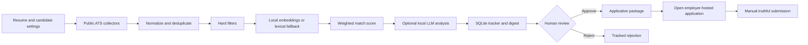

# Open Source AI Job Search

A local-first workflow that discovers public jobs, ranks them against a candidate profile, creates review-ready application drafts, and tracks the application pipeline.

The core workflow runs without any hosted AI service. When Ollama is available, it adds local embeddings, structured job-fit analysis, profile extraction, cover letters, and resume-tailoring suggestions.

## What is implemented

- Public job discovery from Greenhouse, Lever, and Ashby job-board APIs
- Local JSON import for testing and custom feeds
- Cross-source normalization and duplicate merging
- Hybrid match scoring across semantic relevance, skills, title, location, and experience
- Local Ollama support with deterministic offline fallback
- Human approval before application documents can be generated
- Cover-letter, resume-plan, checklist, job snapshot, and optional DOCX generation
- SQLite tracking for statuses, history, workflow runs, scores, and generated files
- HTML digest for new or changed strong matches and optional SMTP delivery
- Streamlit review dashboard
- FastAPI service
- Foreground scheduler, Docker Compose, Windows setup, and automated tests
- No automatic application submission and no CAPTCHA or access-control bypassing

## Workflow



## Quick start on Windows PowerShell

From the project directory:

```powershell
Set-ExecutionPolicy -Scope Process Bypass
.\setup.ps1
```

Run the complete sample workflow without AI:

```powershell
.\.venv\Scripts\Activate.ps1
jobsearch run --no-llm
jobsearch list --min-score 50
```

Open the dashboard:

```powershell
jobsearch dashboard
```

The sample source in `examples/sample_jobs.json` is enabled by default, so the first run works before you add real companies.

The dependency-free core can also be run without installing the package:

```powershell
python run.py --config config/settings.toml run --no-llm
```

## Quick start on macOS or Linux

```bash
./setup.sh
. .venv/bin/activate
jobsearch run --no-llm
jobsearch dashboard
```

## Enable local AI with Ollama

Install and start Ollama, then pull the configured models:

```bash
ollama pull qwen3:4b-instruct
ollama pull nomic-embed-text
```

Run the workflow with local AI enabled:

```bash
jobsearch run --rescore
```

The default chat model is `qwen3:4b-instruct`; the default embedding model is `nomic-embed-text`. Change them in `config/settings.toml` or through environment variables:

```text
OLLAMA_BASE_URL=http://localhost:11434
OLLAMA_CHAT_MODEL=qwen3:4b-instruct
OLLAMA_EMBEDDING_MODEL=nomic-embed-text
```

If Ollama is not running, discovery and matching still complete with deterministic lexical similarity. Draft generation falls back to conservative templates.

## Replace the sample candidate profile

Edit `[candidate]` in `config/settings.toml`, especially:

- `name`, `email`, `phone`, and `location`
- `years_experience`
- `target_roles`
- `preferred_locations`
- `workplace_preferences`
- `skills`
- `exclude_keywords`
- `resume_path`

Supported resume formats are TXT, MD, RST, PDF, and DOCX. PDF and DOCX parsing require the `documents` optional dependencies, which `setup.ps1` and `setup.sh` install.

You can also create `data/profile.json` from a resume:

```bash
jobsearch extract-profile path/to/resume.pdf
```

With Ollama online, the command uses the local model. Without Ollama, it extracts safe basic hints such as email, phone, and explicit years of experience. Review `data/profile.json` before using it.

## Add real job sources

Only public job-board GET APIs are used. Add one block for every company you want to follow.

### Greenhouse

For a hosted URL such as `https://boards.greenhouse.io/example`, the board token is `example`:

```toml
[[sources.greenhouse]]
board = "example"
company = "Example Company"
enabled = true
```

The collector calls:

```text
GET https://boards-api.greenhouse.io/v1/boards/{board}/jobs?content=true
```

### Lever

For a hosted URL such as `https://jobs.lever.co/example`, the site name is `example`:

```toml
[[sources.lever]]
site = "example"
company = "Example Company"
region = "global"
enabled = true
```

Use `region = "eu"` for Lever's EU instance.

### Ashby

For a hosted URL such as `https://jobs.ashbyhq.com/Example`, the board name is `Example`:

```toml
[[sources.ashby]]
board = "Example"
company = "Example Company"
include_compensation = true
enabled = true
```

### Local JSON

The local importer accepts an array of objects:

```json
[
  {
    "id": "unique-role-id",
    "company": "Company",
    "title": "Full Stack Engineer",
    "location": "Remote - India",
    "workplace_type": "remote",
    "employment_type": "Full-time",
    "description": "Full job description",
    "job_url": "https://company.example/jobs/123",
    "apply_url": "https://company.example/jobs/123/apply",
    "posted_at": "2026-11-10T09:00:00Z",
    "salary_text": "Optional salary text"
  }
]
```

Configure it with:

```toml
[[sources.local_json]]
path = "path/to/jobs.json"
enabled = true
```

## Match scoring

The default score is:

```text
45% semantic relevance
25% explicit skill coverage
15% title alignment
10% location and workplace fit
 5% experience fit
```

The weights are configurable under `[scoring]` and are normalized automatically.

Before scoring, excluded phrases produce a hard block. For example, the default `unpaid` phrase rejects unpaid roles. Missing salary is treated as unknown rather than as a failed salary match.

When Ollama is online, candidate and job text are embedded in one batch and compared using cosine similarity. When it is offline, the workflow uses a calibrated token-vector cosine score. Every final score stores its full component breakdown and reasons.

## Human approval and application packages

Application packages are approval-gated:

```bash
jobsearch list --min-score 70
jobsearch show 1
jobsearch approve 1
jobsearch draft 1
jobsearch open 1
```

Each package can contain:

```text
data/applications/<job-id>-<company>-<role>/
  application_checklist.md
  cover_letter.md
  job_snapshot.md
  match_analysis.json
  resume_tailoring_plan.md
  source_resume.<original extension>
  targeted_resume_draft.docx
```

The DOCX is generated only when `python-docx` is installed. The source resume is copied rather than modified. The targeted DOCX includes original resume text and visible tailoring notes; it is a review draft, not a submission-ready claim of accuracy.

## Tracking commands

```bash
jobsearch metrics
jobsearch runs
jobsearch list --status shortlisted
jobsearch status 1 shortlisted --notes "Good role, review tomorrow"
jobsearch approve 1
jobsearch status 1 applied --notes "Applied through employer site"
jobsearch status 1 interview
jobsearch status 1 rejected
jobsearch status 1 offer
jobsearch export data/jobs.csv --min-score 60
jobsearch export data/jobs.json --status applied
```

Supported statuses:

```text
discovered, shortlisted, approved, applied, interview, rejected, offer, archived
```

Every status update creates an immutable event record.

## Dashboard

```bash
jobsearch dashboard
```

Open `http://localhost:8501`. To expose it from a container or VM, use `jobsearch dashboard --host 0.0.0.0`.

The dashboard supports:

- Running discovery and scoring
- Score and status filtering
- Job detail and score review
- Shortlist, approve, apply, interview, reject, and offer actions
- Application-package generation
- Hosted job links
- Downloading generated files

## FastAPI service

```bash
jobsearch serve --host 127.0.0.1 --port 8000
```

Open the interactive API documentation at `http://localhost:8000/docs`.

Main routes:

```text
GET    /health
GET    /profile
GET    /metrics
GET    /jobs
GET    /jobs/{job_id}
PATCH  /jobs/{job_id}/status
POST   /workflow/run
POST   /jobs/{job_id}/draft
GET    /runs
```

Example workflow request:

```bash
curl -X POST http://localhost:8000/workflow/run \
  -H "Content-Type: application/json" \
  -d '{"rescore": false, "use_llm": true}'
```

## Scheduling

Run repeatedly in the foreground:

```bash
jobsearch scheduler --hours 12
```

This runs immediately and then every 12 hours. For production, use the operating system scheduler or the Docker scheduler service so restarts are controlled externally.

### Windows Task Scheduler command

Program:

```text
C:\path\to\project\.venv\Scripts\jobsearch.exe
```

Arguments:

```text
--config C:\path\to\project\config\settings.toml run
```

Start in:

```text
C:\path\to\project
```

### Cron example

```cron
0 8,20 * * * cd /path/to/open-source-ai-job-search && .venv/bin/jobsearch run >> data/scheduler.log 2>&1
```

## Email digests

The workflow always writes an HTML digest when `write_digest = true`.

To send it by SMTP, set:

```text
SMTP_HOST=smtp.example.com
SMTP_PORT=587
SMTP_USERNAME=your-user
SMTP_PASSWORD=your-password
SMTP_FROM=jobs@example.com
SMTP_TO=you@example.com
SMTP_USE_TLS=true
```

Then set this in `config/settings.toml`:

```toml
[workflow]
send_email_digest = true
```

Do not commit `.env`.

## Docker Compose

Start the API, dashboard, and Ollama:

```bash
docker compose up --build -d api dashboard ollama
```

Pull the models into the Ollama container:

```bash
docker compose exec ollama ollama pull qwen3:4b-instruct
docker compose exec ollama ollama pull nomic-embed-text
```

Run one search:

```bash
docker compose exec api jobsearch run
```

Start the optional scheduler profile:

```bash
docker compose --profile scheduler up --build -d
```

Data is persisted under `./data` and Ollama models use the `ollama-data` Docker volume.

## Tests

The core test suite has no third-party dependency:

```bash
PYTHONPATH=src python -m unittest discover -s tests -v
```

Or:

```bash
make test
```

Tests cover:

- Greenhouse, Lever, and Ashby normalization
- Skill, title, location, experience, and hard-block scoring
- Cross-source duplicate merging
- Score persistence and status history
- Complete offline workflow
- Digest and application-package generation

## Project structure

```text
open-source-ai-job-search/
  config/settings.toml
  examples/sample_jobs.json
  examples/sample_resume.txt
  src/jobsearch/
    ai/
      analyzer.py
      matcher.py
      ollama.py
      profile_extractor.py
    collectors/
      ashby.py
      greenhouse.py
      lever.py
      local_json.py
    api.py
    cli.py
    config.py
    dashboard.py
    db.py
    digest.py
    drafts.py
    workflow.py
  tests/
  Dockerfile
  docker-compose.yml
  setup.ps1
  setup.sh
```

## Privacy, reliability, and compliance boundaries

- Resume data, scores, history, and drafts stay on the machine or infrastructure you control.
- Ollama calls use the configured local endpoint; no hosted model API is included.
- Job collection uses public ATS endpoints and a rate-limited HTTP client.
- The workflow does not scrape authenticated pages, bypass CAPTCHAs, or evade access controls.
- The workflow does not auto-submit applications. It opens the employer-hosted application for manual completion.
- Generated text can still be wrong. Review every statement against the source resume and personal records.
- Company career pages and job APIs can change. Collector failures are isolated and recorded as run warnings.
- Respect each website's terms, robots policy, rate limits, and local law.

## Official implementation references

- Greenhouse Job Board API: https://docs.greenhouse.io/job-board
- Lever Postings API: https://github.com/lever/postings-api
- Ashby public Job Postings API: https://developers.ashbyhq.com/docs/public-job-posting-api
- Ollama API: https://docs.ollama.com/api
- Qwen3 model in Ollama: https://ollama.com/library/qwen3
- Nomic Embed Text in Ollama: https://ollama.com/library/nomic-embed-text

## License

MIT. Review the licenses of the models you choose separately.
